# 🌐 Awesome WebGL & 3D Web Engines 🚀

### *The definitive directory of WebGL/WebGPU 3D graphics engines, browser rendering frameworks, WebXR libraries, and interactive visual computing runtimes.*

  
  
  
  
  
  

---

## 📖 Overview & Ecosystem Landscape

**WebGL & 3D Web Engines** empower developers and creative technologists to render hardware-accelerated, photorealistic 2D and 3D computer graphics directly inside the modern web browser without requiring external plugins or client-side installations. Leveraging low-level GPU APIs (**WebGL 1.0/2.0** and the cutting-edge **WebGPU** standard), the web has transformed into a first-class medium for AAA interactive experiences, spatial computing, scientific visualization, and immersive e-commerce.

From lightweight canvas utilities to full-featured game engines complete with physics, audio, entity-component systems (ECS), and visual shader graphs, this ecosystem spans the entire graphics pipeline from digital asset creation to browser deployment.

### 🔍 Key Technology Domains
- 🎮 **Browser Game Engines & ECS**: Complete game runtimes with physics engines, skeletal animation systems, spatial audio, and hierarchical scene trees (e.g., *PlayCanvas*, *Babylon.js*).
- 🌐 **General-Purpose 3D Scene Graphs**: Flexible, low-friction libraries for rendering custom geometry, materials, lighting, post-processing shaders, and camera rigs (e.g., *Three.js*, *OGL*).
- ⚛️ **Declarative & Component Runtimes**: Reactive abstractions binding 3D render loops to modern frontend frameworks like React, Vue, and Svelte (e.g., *React Three Fiber*, *Drei*).
- 🌍 **Geospatial & Massive Digital Earth Engines**: High-performance streaming of 3D Tiles, terrain heightmaps, bathymetry, photogrammetry, and satellite imagery (e.g., *CesiumJS*, *Mapbox GL JS*).
- 🔬 **Scientific, Big Data & Point Cloud Visualization**: Hardware-accelerated rendering of multi-gigabyte point clouds, medical scans, volumes, and geospatial flow layers (e.g., *deck.gl*, *Potree*, *vtk.js*).
- 🕶️ **WebXR & Spatial Computing**: Declarative entity markup and WebXR device APIs bringing virtual and augmented reality directly to headsets and mobile web browsers (e.g., *A-Frame*, *model-viewer*).

---

## 📑 Table of Contents
- [📈 Sector Overview & Market Dynamics](#-sector-overview--market-dynamics)
- [☁️ SaaS & Hosted Platforms](#️-saas--hosted-platforms)
- [🐙 Open-Source GitHub Projects](#-open-source-github-projects)
- [🧭 Architectural Decision Matrix](#-architectural-decision-matrix)
- [🤝 How to Contribute](#-how-to-contribute)
- [💖 Support & Community](#-support--community)
- [⭐ Star History](#-star-history)
- [⚖️ Disclaimer](#️-disclaimer)

---

## 📈 Sector Overview & Market Dynamics

The global 3D visualization, interactive 3D web software, and WebGL rendering engine market is estimated at **$3.8 Billion in 2024** and is projected to expand to **$11.7 Billion by 2030**, advancing at a sustained compound annual growth rate (CAGR) of **~20.6%**. This rapid expansion is catalyzed by mainstream e-commerce adoption of interactive 3D product configurators, architectural digital twins, automotive visualizers, and the emergence of **WebGPU** delivering compute shaders and near-native GPU execution to all major browsers.

The sector exhibits **moderate fragmentation**: while the open-source foundational layer (*Three.js* and *Babylon.js*) commands an overwhelming majority of core developer mindshare for code-first rendering, the commercial SaaS layer is segmented into specialized verticals rather than a single winner-take-all monopoly—*Epic Games / Sketchfab* dominates 3D model asset marketplaces; *Snap / PlayCanvas* leads browser-native game development; *Bentley Systems / Cesium ion* dominates GIS and geospatial digital earth tiling; and modern startups like *Spline* and *Vectary* capture the no-code designer-to-developer interactive 3D pipeline.

---

## ☁️ SaaS & Hosted Platforms

Below is a curated breakdown of prominent commercial SaaS platforms, cloud asset pipelines, and hosted 3D studios, sorted descending by corporate scale and valuation.

| 🏢 Platform / Service | 📊 Company Scale (Valuation / Revenue) | 💳 Starting Tier Pricing | 🎁 Free Tier / Trial Limits | 🛠️ Core Strengths & Primary Focus |
| :--- | :--- | :--- | :--- | :--- |
| [**Sketchfab**](https://sketchfab.com/) | **Epic Games** ~$31.5 Billion Valuation *(~$5.6B+ Annual Revenue)* | **$15/month** (Pro plan billed annually at $180/yr) or **$24/month** billed monthly | **Free Forever Basic Plan**: Up to **10 public 3D model uploads/month**, **100 MB** max upload file size, and access to 1M+ free downloadable 3D models | Industry-standard 3D/AR model publishing platform, universal WebGL viewer embed, real-time PBR material editor, and premier 3D digital asset marketplace. |
| [**PlayCanvas Cloud**](https://playcanvas.com/) | **Snap Inc.** ~$16.0 Billion Market Cap *(~$4.6B+ Annual Revenue)* | **$15/month** (Personal Plan) or **$50/seat/month** billed annually for Organization teams | **Free Forever Plan**: **1 GB asset storage**, unlimited public projects, full access to collaborative browser 3D editor and real-time code editor | High-performance WebGL/WebGPU game engine and cloud-native collaborative scene editor with built-in physics, lightmapping, and instant URL playtesting. |
| [**Cesium ion**](https://cesium.com/platform/cesium-ion/) | **Bentley Systems** ~$15.0 Billion Market Cap *(~$1.3B+ Annual Revenue)* | **$149/month** (Commercial Tier for individuals and small businesses) | **Free Forever Community Plan**: **5 GB 3D Tiles/asset storage**, **50,000 tile requests/month**, and 75 geocodes/month for non-commercial evaluation | Cloud 3D tiling pipeline transforming massive point clouds, photogrammetry, and BIM data into streamable 3D Tiles for CesiumJS. |
| [**Unity WebGL / Cloud**](https://unity.com/) | **Unity Software Inc.** ~$9.0 Billion Market Cap *(~$2.1B+ Annual Revenue)* | **$187/month** (Unity Pro billed annually at $2,040/seat/year) | **Free Forever Plan** (Unity Personal): Full WebGL export support for developers/studios with under **$100,000** in trailing 12-month revenue/funding | Comprehensive cross-platform game engine with WebAssembly/WebGL export pipeline, WebGPU experimental backend, and cloud asset hosting. |
| [**ThreeKit**](https://www.threekit.com/) | **ThreeKit Inc.** ~$120 Million Valuation *(~$65M+ VC Funding)* | **$1,500/month** base commercial deployment fee (~$18,000 annual contract commitment) | **14-Day Free Sandbox Trial** for visual configurator and asset pipeline testing available via guided enterprise developer onboarding | Enterprise 3D visual commerce platform specializing in parametric 3D product configurators, virtual photography, and WebAR retail experiences. |
| [**Spline Cloud**](https://spline.design/pricing) | **Spline Inc.** ~$80 Million Valuation *(~$15M+ Series A Funding)* | **$9/month** (Super tier billed annually at $108/yr) or **$12/month** billed monthly | **Free Forever Plan**: Unlimited personal files, 1 team project, up to **2 team files**, and full interactive 3D WebGL exports *(Spline watermark)* | Collaborative design-to-web 3D authoring studio featuring physics, procedural materials, event interactions, and React/HTML embed code export. |
| [**Vectary**](https://www.vectary.com/pricing/) | **Vectary Inc.** ~$25 Million Valuation *(~$10M+ VC Funding)* | **$19/month** (Pro plan billed annually at $228/yr) or **$25/month** billed monthly | **Free Forever Starter Plan**: Up to **10 3D projects**, **1,000 WebGL viewer views/month**, and AR viewing on iOS/Android *(with Vectary badge)* | Browser-based 3D modeling and configurator platform with photorealistic real-time rendering, interactive hotspot annotations, and Figma/Webflow integrations. |
| [**Verge3D**](https://www.soft8soft.com/verge3d/) | **Soft8Soft LLC** ~$8 Million Valuation *(Bootstrapped / Profitable)* | **$290 one-time fee** (Freelancer License perpetual with 1-year updates) or **$990** for Team License | **Free Unlimited-Time Trial**: Full feature access with Blender, 3ds Max, and Maya integrations; trial output includes a lightweight trial watermark | Bridge technology enabling 3D artists to convert Blender, 3ds Max, and Maya scenes into interactive WebGL applications without writing raw JavaScript code. |

---

## 🐙 Open-Source GitHub Projects

The open-source 3D web ecosystem provides total rendering control, uncompromised performance customization, and immunity to proprietary vendor lock-in. Below are the leading open-source repositories, **sorted descending by GitHub_Stars_Count**.

### 1. [Three.js](https://github.com/mrdoob/three.js) 
- **Primary Language**: JavaScript | **License**: MIT
- **Summary**: The world's most widely adopted open-source 3D library for the web. Provides an accessible yet deep scene graph abstraction over WebGL and WebGPU. Features extensive loaders for industry formats (glTF, USDZ, FBX, OBJ), physically based rendering (PBR), shadows, post-processing passes, skinning, morph targets, and thousands of battle-tested community examples.

### 2. [PixiJS](https://github.com/pixijs/pixijs) 
- **Primary Language**: TypeScript | **License**: MIT
- **Summary**: The HTML5 creation engine delivering ultra-fast 2D and 2.5D visual rendering via WebGL and WebGPU with seamless Canvas fallback. Renowned for blazingly fast sprite batching, custom filter shaders, interactive stage graphs, and powering demanding web games, banners, and data dashboards.

### 3. [React Three Fiber](https://github.com/pmndrs/react-three-fiber) 
- **Primary Language**: TypeScript | **License**: MIT
- **Summary**: A powerful React renderer for Three.js created by Poimandres. Enables developers to build complex, declarative 3D scene graphs using standard React components, hooks, state management, and props without any performance overhead or feature limitations compared to vanilla Three.js.

### 4. [Babylon.js](https://github.com/BabylonJS/Babylon.js) 
- **Primary Language**: TypeScript | **License**: Apache-2.0
- **Summary**: Microsoft's complete, batteries-included 3D web game and rendering engine. Features production-grade WebGPU support, node-based material editors, advanced particle systems, integrated Havok and Ammo physics engines, GUI layers, spatial audio, and deep inspection tools designed for enterprise games and architectural visualization.

### 5. [A-Frame](https://github.com/aframevr/aframe) 
- **Primary Language**: JavaScript | **License**: MIT
- **Summary**: Web-first declarative framework for building spatial computing and WebXR experiences. Authored via intuitive HTML custom elements `<a-scene>`, `<a-box>`, `<a-entity>`, A-Frame is built atop Three.js and implements an entity-component-system architecture compatible with VR headsets, AR mobile browsers, and desktop screens.

### 6. [PlayCanvas Engine](https://github.com/playcanvas/engine) 
- **Primary Language**: JavaScript / TypeScript | **License**: MIT
- **Summary**: Lightweight, high-octane WebGL/WebGPU graphics and game engine engineered specifically for performance on mobile devices. Features rigid-body physics via Ammo.js, 3D audio via Web Audio API, lightmaps, morph animations, and an entity-component design powering high-traffic web games.

### 7. [CesiumJS](https://github.com/CesiumGS/cesium) 
- **Primary Language**: JavaScript | **License**: Apache-2.0
- **Summary**: The leading open-source JavaScript library for world-scale 3D globes and geospatial visualization. Dynamically streams massive 3D Tiles, terrain elevation meshes, satellite imagery, point clouds, and BIM models with high precision, spatial indexing, and time-dynamic entity simulations.

### 8. [deck.gl](https://github.com/visgl/deck.gl) 
- **Primary Language**: TypeScript | **License**: MIT
- **Summary**: Uber's flagship WebGL2 and WebGPU-powered data visualization framework. Designed to render millions of data points, polygons, arcs, and heatmaps in real time on top of interactive map basemaps with composable visual layers and smooth GPU-accelerated aggregations.

### 9. [Mapbox GL JS](https://github.com/mapbox/mapbox-gl-js) 
- **Primary Language**: TypeScript / JavaScript | **License**: Mapbox TOS / 3-Clause BSD (v1.x)
- **Summary**: The industry benchmark for client-side vector tile rendering using WebGL. Provides dynamic styling, 3D terrain draping, hillshading, extruded 3D building geometry, camera fly-through animations, and rich interactive geospatial UI layers.

### 10. [drei](https://github.com/pmndrs/drei) 
- **Primary Language**: TypeScript / JavaScript | **License**: MIT
- **Summary**: The standard library of useful helpers, abstraction components, camera controllers (OrbitControls), loaders, shaders, environment maps, and text primitives for React Three Fiber (`@react-three/fiber`), dramatically accelerating 3D scene construction.

### 11. [model-viewer](https://github.com/google/model-viewer) 
- **Primary Language**: TypeScript | **License**: Apache-2.0
- **Summary**: Google's official Web Component `<model-viewer>` for reliably embedding interactive 3D and AR models on the web. Automatically handles responsive resizing, progressive rendering, staging lights, shadows, and seamless augmented reality handoff to iOS Quick Look and Android Scene Viewer.

### 12. [Potree](https://github.com/potree/potree) 
- **Primary Language**: JavaScript | **License**: BSD-2-Clause
- **Summary**: Free open-source WebGL point cloud renderer designed for massive datasets. Utilizes an octree level-of-detail (LOD) streaming algorithm to display billions of LiDAR, photogrammetry, and laser-scanned points smoothly inside web browsers.

### 13. [regl](https://github.com/regl-project/regl) 
- **Primary Language**: JavaScript | **License**: MIT
- **Summary**: Fast, functional, and stateless WebGL wrapper. Replaces the mutable state machine of WebGL with declarative draw commands, drastically reducing boilerplate, eliminating state leaks, and optimizing GPU pipeline state caching.

### 14. [OGL](https://github.com/oframe/ogl) 
- **Primary Language**: JavaScript | **License**: MIT
- **Summary**: Minimal, high-performance WebGL library engineered for creative technologists and frontend developers who want raw control and a lightweight footprint (~28 KB gzipped) when Three.js is heavier than necessary.

### 15. [three-mesh-bvh](https://github.com/gkjohnson/three-mesh-bvh) 
- **Primary Language**: JavaScript | **License**: MIT
- **Summary**: Fast Bounding Volume Hierarchy (BVH) implementation for Three.js. Accelerates raycasting, collision detection, nearest-point queries, and mesh clipping by orders of magnitude for complex 3D meshes.

### 16. [TWGL.js](https://github.com/greggman/twgl.js) 
- **Primary Language**: JavaScript | **License**: MIT
- **Summary**: A tiny, elegant WebGL helper library from Gregg Tavares that removes the repetitive verbosity of setting up buffers, attributes, uniforms, textures, and framebuffers without imposing an opinionated scene graph.

### 17. [ClayGL](https://github.com/pissang/claygl) 
- **Primary Language**: JavaScript | **License**: BSD-2-Clause
- **Summary**: Configurable WebGL graphic library developed by the Baidu team for high-quality rendering, post-processing effects, deferred shading, HDR, screen-space reflections, and rich visualization charts in ECharts.

### 18. [luma.gl](https://github.com/visgl/luma.gl) 
- **Primary Language**: TypeScript | **License**: MIT
- **Summary**: High-performance, portable WebGL2 and WebGPU graphics framework from the Vis.gl community. Underpins deck.gl with modern shader management, uniform buffers, transform feedback, and compute shader pipelines.

### 19. [vtk.js](https://github.com/Kitware/vtk-js) 
- **Primary Language**: JavaScript | **License**: BSD-3-Clause
- **Summary**: Kitware's JavaScript implementation of the Visualization Toolkit (VTK). Specialized in scientific data visualization, medical image processing (DICOM, volume rendering), finite element analysis, and engineering simulation meshes in the browser.

### 20. [xeogl](https://github.com/xeolabs/xeogl) 
- **Primary Language**: JavaScript | **License**: MIT
- **Summary**: Data-driven WebGL scene engine designed specifically for engineering, CAD, BIM, and architectural applications with support for metadata models, slicing planes, and glTF asset viewing.

---

## 🧭 Architectural Decision Matrix

| Project | Primary Focus | Best For | Learning Curve | Mobile Performance | WebGPU Support |
| :--- | :--- | :--- | :--- | :--- | :--- |
| **Three.js** | General-purpose 3D | Custom scenes, creative websites, interactive portfolios | Moderate | High (with optimization) | Production Ready (Three.js WebGPU Renderer) |
| **Babylon.js** | Full Game/Visual Engine | Web games, enterprise digital twins, architectural renders | Moderate | Excellent | Native First-Class (Babylon WebGPU Engine) |
| **React Three Fiber** | Declarative React 3D | React/Next.js/Vite frontend apps & dashboards | Gentle (for React devs) | High | Supported via Three.js backend |
| **PlayCanvas** | Web Game Runtime / ECS | Multiplayer games, interactive ads, mobile browser games | Gentle to Moderate | Outstanding | Complete WebGPU Engine Support |
| **CesiumJS** | Geospatial / Digital Earth | GIS, satellite telemetry, city-scale 3D Tiles, BIM maps | Steep | Moderate to High | Active Roadmap Integration |
| **model-viewer** | Single Model Embed & AR | E-commerce product pages, quick WebAR viewing | Minimal (HTML Tag) | Near Native | Abstracted Backend |
| **deck.gl** | Big Data Visualization | Millions of geospatial points, taxi trips, GPS routes | Moderate | High | Native WebGPU Layering via luma.gl |
| **OGL** | Minimal WebGL Library | Micro-sites, lightweight shaders, banner animations | Advanced | Blazing Fast | Focused on lightweight WebGL |

---

## 🤝 How to Contribute

We welcome contributions from graphics engineers, 3D artists, and web developers worldwide!

1. 🍴 **Fork the Repository** to your own GitHub account.
2. 🌿 **Create a Feature Branch** (`git checkout -b feature/add-engine-name`).
3. 📝 **Add or Update Entries** in `README.md` following the established structure:
   - For SaaS: Name, link, company scale/valuation, specific starting price, precise free tier/trial limit, and key strengths.
   - For Open-Source: Name, GitHub repository link, Stars_Badge (`style=social&color=white` linking to stargazers), language, license, and concise technical summary.
4. 🧪 **Verify Markdown Rendering and Links** to ensure clean table alignment and active URLs.
5. 🚀 **Submit a Pull Request** describing your additions and architectural rationale.

---

## 💖 Support & Community

Thank you for exploring **Awesome WebGL & 3D Web Engines**! If this curated directory helps you architect web graphics, benchmark 3D tools, or discover cutting-edge WebGPU runtimes:

- ⭐ **Star this repository** to improve discoverability for other graphics engineers!
- 🍴 **Fork and share** with fellow developers, creative technologists, and 3D communities.
- 💬 **Join our Discord** at [discord.gg/jc4xtF58Ve](https://discord.gg/jc4xtF58Ve) to connect with engineers building on WebGL, WebGPU, and 3D web engines.
- ☕ **Sponsor the Project**: Help fund continued curation, performance benchmarking, and open-source directory maintenance via the [GitHub Sponsor Dashboard](https://github.com/sponsors/ishandutta2007).

---

## ⭐ Star History

---

## ⚖️ Disclaimer

- This repository is a **community-curated directory** intended for technical benchmarking, architectural decision-making, and educational research.
- Product names, company trademarks, and logos belong to their respective copyright and trademark owners.
- SaaS pricing tiers, free tier allowances, and corporate valuations change over time; refer to official platform websites for current commercial terms.
- 3D web applications can be GPU- and memory-intensive. Always profile draw calls, texture memory, and vertex budgets across low-end mobile hardware, provide accessible UI fallbacks, and respect user motion preferences (`prefers-reduced-motion`).

---

  <b>Built with ❤️ for creative technologists, graphics engineers, and 3D web builders worldwide.</b>

